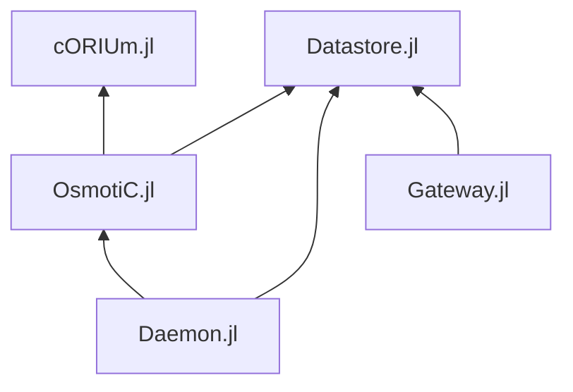

# Development

## The repositories

Each component is a Julia package in its own repository. They depend on each
other **by relative path** (in their `Manifest.toml`), so they must be checked
out side by side, in one folder:

```
git/
├── Hydrorisk      this repository: deployment, platform documentation   (main)
├── Gateway.jl     REST API and QGIS plugin                              (main)
├── Daemon.jl      job service                                           (main)
├── OsmotiC.jl     model: prepare, execute, post                         (dev)
├── cORIUm.jl      solver                                                (dev)
└── Datastore.jl   database access                                       (main)
```



An arrow is a dependency. cORIUm depends on none of the others: it is the
numerical engine, usable alone. The Docker images and this documentation are
built from these checkouts, on whatever branch each one has checked out.

## Working on a package

- `julia --project=<Package>.jl -e 'using Pkg; Pkg.instantiate()'` once per
  package; the first load precompiles the stack (minutes for OsmotiC and
  Daemon).
- [Revise](https://timholy.github.io/Revise.jl/stable/) reloads the code you
  edit without restarting Julia. It is a development tool, not a dependency
  of any package: load it from your `~/.julia/config/startup.jl`, once per
  machine:

  ```julia
  try
      using Revise
  catch e
      @warn "Revise not loaded" exception=e
  end
  ```

- A local PostgreSQL with PostGIS, and the database variables (see
  [Configuration](@ref)), to run jobs or the API outside Docker.

## Tests

| Package | Command | Needs a database |
|:--|:--|:--|
| Datastore, OsmotiC, Daemon | `julia --project=. -e 'using Pkg; Pkg.test()'` | no |
| Gateway | `julia --project=test test/runtests.jl` | no |
| cORIUm | `julia --project=. -e 'using Pkg; Pkg.test()'` | no |

Datastore, OsmotiC and Daemon check that each global name they use resolves
(a missing import fails the tests, not a job in production), and the
boundaries are tested from both sides: cORIUm and OsmotiC each check the interface between them, the
daemon runs real worker processes, Gateway checks that its OpenAPI
specification lists exactly its routes.

## Rules that span the packages

- **The API specification follows the code.** Any change to a Gateway
  endpoint updates `openapi.yaml` in the same change, and the matching plugin
  change goes with it.
- **The plugin keeps the platform's name** (`hydrorisk` provider and settings
  keys): users' saved connections depend on it.
- **One owner per concern**: SQL only in Datastore (and a few transactional
  queries in Gateway), job status only in the daemon, numerics only in cORIUm.
- **Values are bound as SQL parameters**, never spliced into queries.
- **A change spanning packages** — a renamed variable, a new interface
  function — lands in each repository on its own branch, and the images are
  rebuilt together.

## Documentation

Each package documents itself in its `docs/` folder, built with Documenter in
the package's own environment:

```sh
cd <Package>.jl
julia --project=docs -e 'using Pkg; Pkg.instantiate()'   # once
julia --project=docs docs/make.jl
python3 -m http.server --directory docs/build
```

This site assembles them: `Hydrorisk/docs/make.jl` builds every package's
documentation, then these platform pages, and combines them with
MultiDocumenter — one top bar, one search.

```sh
cd Hydrorisk
julia --project=docs -e 'using Pkg; Pkg.instantiate()'   # once
julia --project=docs docs/make.jl                        # all packages, then the site
julia --project=docs docs/make.jl --skip-packages        # reuse the packages' last builds
python3 -m http.server --directory docs/build            # http://localhost:8000
```

Serve the sites over HTTP: opened as files, the diagrams and the search do
not load. Publishing the site is a separate step.
