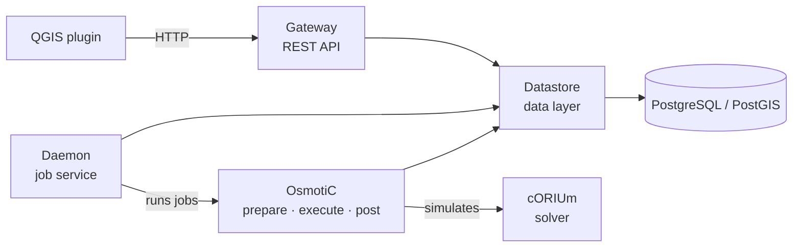

# Hydrorisk

Hydrorisk is a platform for simulating surface runoff and flooding: from QGIS,
a user uploads their data — terrain, land use, soils, precipitation — sets up
a simulation over an area and a period, and gets back maps of water heights,
discharges and velocities, step by step and as maxima. The simulations solve
the shallow-water (Saint-Venant) equations on CPU or GPU.

This site gathers the documentation of every component; the bar at the top
switches between them, and the search covers them all.

## Components

| Component | Role | Documentation |
|:--|:--|:--|
| **QGIS plugin** | the users' interface: upload data, set up and follow jobs, view results | [Gateway → QGIS plugin](hydrorisk://gateway/qgis_plugin/) |
| **Gateway** | the REST API, the only way in: authenticates, records requests, serves data | [Gateway](hydrorisk://gateway/) |
| **Daemon** | runs the submitted jobs on worker processes, records their status | [Daemon](hydrorisk://daemon/) |
| **OsmotiC** | turns a job into a simulation: inputs onto one grid, the run, the results | [OsmotiC](hydrorisk://osmotic/) |
| **cORIUm** | the numerical solver of the shallow-water equations, on CPU or GPU | [cORIUm](hydrorisk://corium/) |
| **Datastore** | the database: schema, users and tokens, datasets, jobs; the admin console | [Datastore](hydrorisk://datastore/) |

Each is a Julia package in its own repository, side by side in one folder
(the plugin ships with Gateway). This repository, `Hydrorisk`, holds what
belongs to the platform as a whole: the Docker deployment and this site.

## Principles

- **The database is the only link** between the API and the daemon: Gateway
  writes requests and answers at once; the daemon picks them up and writes the
  status back. Neither calls the other.
- **Datasets are personal.** Every dataset and job belongs to one user; a job
  can only use its owner's datasets.
- **One way in.** Clients reach the platform only through Gateway, with a
  token an administrator issued; the database is not exposed to them.
- **Each package has one job**, and the boundary between two is a small,
  declared interface — documented, and tested on both sides.

## Where to start

- To understand how it works: [A job, end to end](@ref).
- To install the platform: [Deployment](@ref), then [Configuration](@ref).
- To work on the code: [Development](@ref).
