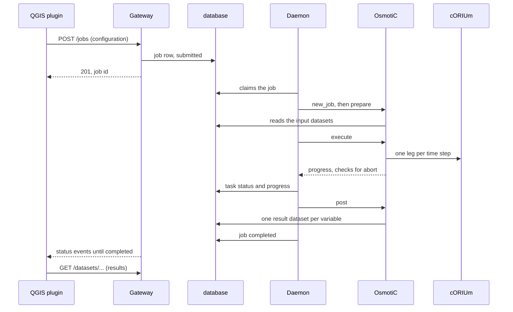

# A job, end to end

What happens between a user clicking *Submit* in QGIS and the results
appearing as layers — and which component does each part. Each step links to
the page that details it.

## 1. Data in

The user uploads their datasets from the plugin's **Dataset** tool: rasters,
shapefiles, CSV tables, or folders of radar precipitation files. Gateway
receives the file and Datastore imports it into its own table, owned by the
user, under a category that says which job input it can fill.

→ [Datastore: data import](hydrorisk://datastore/data_import/) ·
[Gateway: datasets](hydrorisk://gateway/using_the_api/#Datasets)

## 2. The job is set up and submitted

The plugin's **Job** wizard builds the job configuration from the catalogs
the platform publishes: a name, the dataset for each input (elevation, land
use, precipitation, …), the solver settings, the results to keep, and the
area and period. Gateway checks the name and that every input is one of the
user's datasets, gives the job its id, and records it as `submitted`.

→ [OsmotiC: job configuration](hydrorisk://osmotic/configuration/) ·
[Gateway: the life of a job](hydrorisk://gateway/using_the_api/#The-life-of-a-job)

## 3. The daemon runs it

Within a second, the daemon claims the job and hands it to a free worker
process, which runs OsmotiC's three tasks:

1. **prepare** reads every input dataset through Datastore, clipped to the
   area, fits them onto the grid of the elevation model, and writes the
   simulation's input file;
2. **execute** runs cORIUm over the period, one leg per time step of the
   input series, reporting progress at each checkpoint and stopping if the
   user aborts;
3. **post** stores the requested results as raster datasets, owned by the
   user and linked to the job.

The daemon records each task's status and progress in the database.

→ [Daemon: job lifecycle](hydrorisk://daemon/job_lifecycle/) ·
[OsmotiC: workflow](hydrorisk://osmotic/workflow/) ·
[cORIUm: input file format](hydrorisk://corium/input_format/)

## 4. Following, pausing, aborting, resubmitting

The plugin's **Job Monitor** follows the jobs live (server-sent events from
Gateway, which reads the status the daemon writes). A pause or an abort
reaches the running worker through the database and stops it within a couple
of seconds, between two solver time steps. A **paused** job frees its worker
and keeps its state — cORIUm saves it, OsmotiC records where the run stopped —
so **Resume** continues where it stopped. A resubmitted job re-runs only the
tasks that did not complete, from their start.

→ [Daemon: job lifecycle](hydrorisk://daemon/job_lifecycle/) ·
[OsmotiC: pause and resume](hydrorisk://osmotic/workflow/#Pause-and-resume) ·
[cORIUm: stopping a run](hydrorisk://corium/functions/public_api/#Stopping-a-run-and-continuing-it)

## 5. Results out

The results are datasets like any other: listed in the **Dataset** tool,
loaded as layers, stepped through in the **Timeserie Explorer**, usable as
inputs of another job. Deleting the job deletes them too.

→ [OsmotiC: outputs](hydrorisk://osmotic/outputs/)
